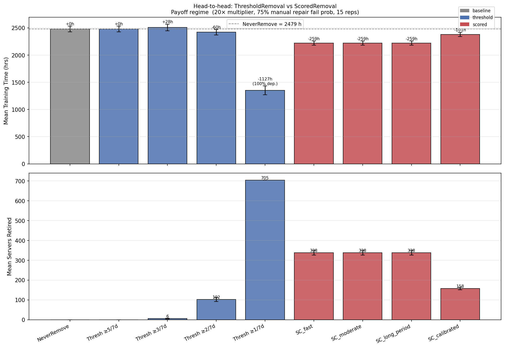
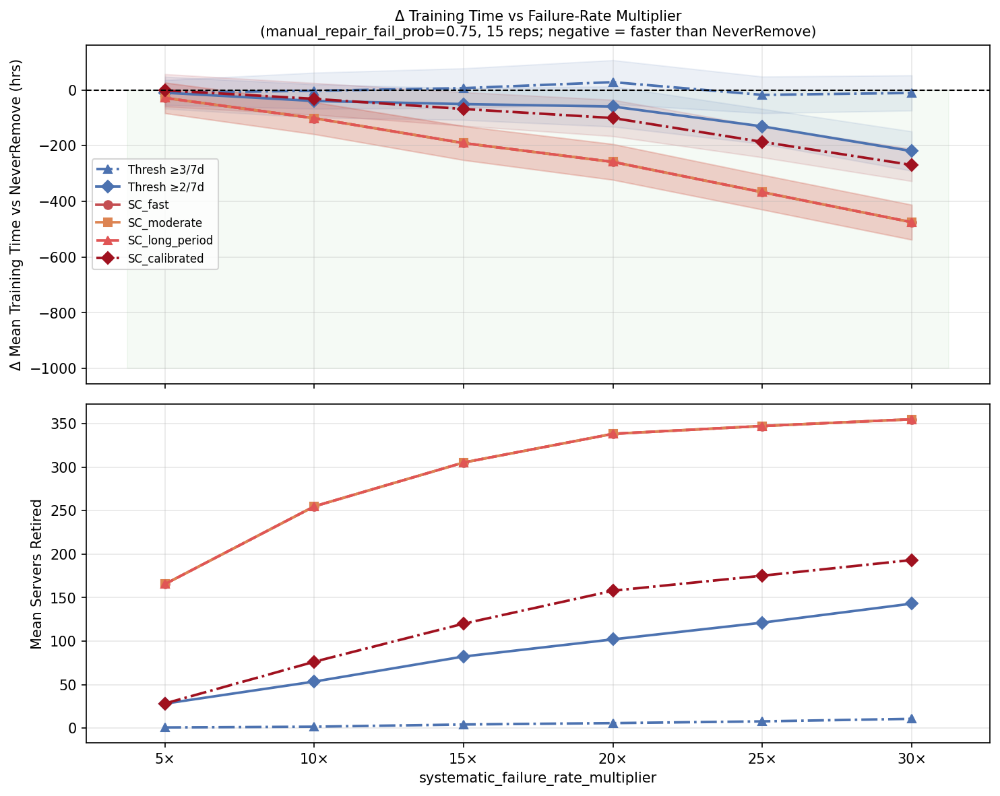
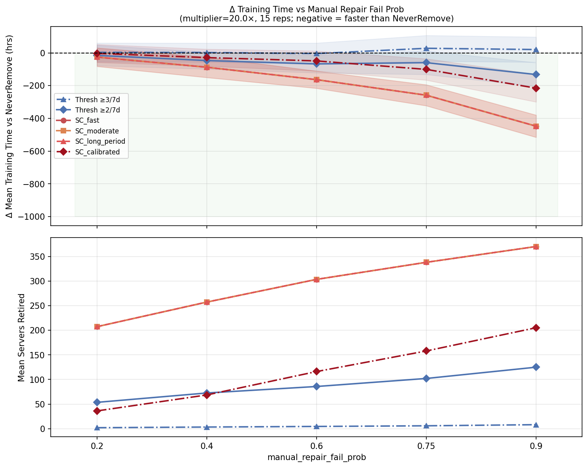

# Retirement Policy Comparison Report
## ScoredRemoval vs ThresholdRemoval in Large-Scale AI Cluster Simulation

**Data:** `examples/scored_vs_threshold_figures/results.csv` (86 rows, 15 replications
per cell; per-run rows in `replications.csv`), produced by `examples/scored_vs_threshold.py`
at commit `be13c89` (run log: `examples/scored_vs_threshold_figures/run.log`). Repairs
follow the paper's model: `prob_auto_to_manual` is the probability that auto repair
escalates, independent of the silent auto-repair failure `auto_repair_fail_prob`.
Date: 2026-11-20.

> **What changed on 2026-11-20.** Rerun after the paper-conformance fixes (CHANGELOG).
> The script does not set `diagnosis_probability`, so it now runs at the Table I default
> of **0.8**; the previous version used 1.0. That default change accounts for all of the
> differences (this regime never borrows a spare or stalls). Removal policies decide only
> when a server finishes repair, which happens only after a diagnosed failure, and
> `ScoredRemoval`'s score moves only on diagnosed failures; so with 20% of failures
> undiagnosed both policies retire fewer bad servers and save less: at the headline setting `SC_fast` saves 259h (was 317h) and
> `ThresholdRemoval(≥2/7d)` 60h (was 76h). The ranking is unchanged — `ScoredRemoval`
> still leads wherever the difference is measurable — but at the mildest settings (5×
> multiplier, 20% repair fail probability) its lead is no longer distinguishable from
> zero. How retirement compares with failure-aware *scheduling* as diagnosis degrades is
> in `DIAGNOSIS_SWEEP_REPORT.md` §"Crossover" and `SCHEDULING_COMPARISON_REPORT.md`.

---

## 1. Executive Summary

This report compares two server retirement policies implemented in AIReSim —
`ThresholdRemoval` and `ScoredRemoval` — in the parameter regime where active
retirement is known to improve training time.

**Key findings:**

- `ScoredRemoval` outperforms `ThresholdRemoval` at every tested condition, with a lead
  that grows with severity: from 19h at a 5× failure multiplier (z = 1.1, not
  significant) to **256h (10%) at 30×**, and from 10h at a 20% manual repair fail
  probability (z = 0.7, not significant) to **316h (13%) at 90%**. At the regime's
  headline setting (20×, 75%) `SC_fast` saves **259h (10.4%)** against
  `ThresholdRemoval(≥2/7d)`'s 60h (2.4%). The best measured improvement over
  `NeverRemove` is **475h (17.5%)** at a 30× multiplier.
- The win is not due to the uptime-credit mechanism. In any large-cluster job
  (≥ ~1000 servers), aggregate failures arrive far faster than any practical
  `time_period`, so credits are never earned. The policy degenerates to a
  **total lifetime failure count threshold** — a better discriminator than
  ThresholdRemoval's rolling window.
- `ThresholdRemoval`'s window is consistent with this result: `ThresholdRemoval(≥2/7d)`
  retires 102 servers where `ScoredRemoval` retires 338. A server that escapes a 7-day
  failure window (e.g., because it spent the week in the repair shop) is re-admitted to
  the pool still broken, while `ScoredRemoval`'s cumulative score remembers every past
  failure.
- The conservative `ThresholdRemoval(≥3/7d)` retires only about 6 servers per run and has
  no measurable effect anywhere (+28h at the headline setting, z = 1.4); `≥1/7d` retires
  every server on its first failure and depletes the cluster in 100% of runs.
- The `success_increment` / `time_period` parameters are structurally inert at
  the 4096-server scale tested here. Meaningful uptime crediting would require
  either a cluster smaller than ~200 servers or a `time_period` set to match the
  typical inter-failure chunk duration (~5–10 minutes at this scale).

---

## 2. Simulation Regime

All experiments use the **retirement-payoff regime** identified in earlier
analysis (`examples/retirement_payoff.py`). Three conditions must hold
simultaneously for retirement to reduce training time:

| Parameter | Value | Notes |
|---|---|---|
| `working_pool_size` | 4600 | 488 headroom above job minimum (4112) |
| `spare_pool_size` | 200 | |
| `job_size` | 4096 | |
| `warm_standbys` | 16 | |
| `job_length` | 14 days (compute) | |
| `random_failure_rate` | 2× default | ~0.02 failures/day/good server |
| `systematic_failure_rate_multiplier` | 20× (baseline) | Bad server TTF ≈ 2.4 days |
| `systematic_failure_fraction` | 8% | 384 bad servers out of 4800 total |
| `recovery_time` | 60 min | Expensive checkpointing overhead |
| `auto_repair_fail_prob` | 0.60 | |
| `manual_repair_fail_prob` | 0.75 (baseline) | Effective fix rate ≈ 28% |
| `prob_auto_to_manual` | 0.80 | |
| `diagnosis_probability` | 0.80 | Table I default; 20% of failures undiagnosed |
| Replications | 15 per data point | |

**Why this regime matters:** with a 28% effective fix rate, 72% of repaired
bad servers return to the pool still broken and resume failing every 2.4 days.
Each failure incurs 60 minutes of recovery overhead. Retiring the worst
offenders eliminates this recurring cost.

---

## 3. Policy Descriptions

### ThresholdRemoval

Retires a server if it accumulates **≥ N failures within any rolling time
window** (here: 7 days). Tested thresholds: 5, 3, 2, and 1 failure(s) per
7-day window.

```python
ThresholdRemoval(max_failures=2, window_minutes=7 * 24 * 60)
```

The window creates a **forgiveness mechanism**: failures older than 7 days are
forgotten. A server that fails twice, then successfully survives a full repair
without re-failing, is treated as clean.

### ScoredRemoval

Assigns each server an `initial_score`. On every failure the score decreases by
`failure_penalty`; after each uninterrupted run of length ≥ `time_period` the
score increases by `success_increment`. A server is retired when its score falls
to or below `retirement_threshold`.

Four configurations were tested, calibrated against the bad/good server TTF
ratio in this regime (2.4 days vs 50 days):

| Config | `initial_score` | `failure_penalty` | `success_increment` | `time_period` | Effective failures to retire |
|---|---|---|---|---|---|
| SC_fast | 100 | 60 | 10 | 1 day | 2 |
| SC_moderate | 100 | 50 | 15 | 1 day | 2 |
| SC_long_period | 100 | 50 | 10 | 4 days | 2 |
| SC_calibrated | 100 | 40 | 10 | 3 days | 3 |

> **Note on credit activation.** With 4096 active servers and a 20× failure
> multiplier, the aggregate failure arrival rate is ~0.15/minute, producing run
> chunks of ~7 minutes on average. Since `floor(7 min / time_period) = 0` for
> any `time_period` ≥ a few minutes, uptime credits are never earned in
> practice. The policy degenerates to a pure cumulative failure count:
> `ceil(initial_score / failure_penalty)` failures → retire. SC_fast,
> SC_moderate, and SC_long_period all compute to the same value (2 failures),
> producing identical results.

---

## 4. Head-to-Head Comparison (20× multiplier, 75% repair fail prob)



**Effective Training Ratio (ETR)** = `job_length / total_training_time` = `336 hrs / training_time`.
ETR measures the fraction of wall-clock time spent on useful computation; overhead (recovery,
host selection, spare-pool waits) reduces it below 1.0.

| Policy | Mean Training Time (hrs) | ETR | Δ vs NeverRemove | Servers Retired | Depleted |
|---|---|---|---|---|---|
| NeverRemove | 2479.3 ± 51.6 | 13.6% | — | 0 | — |
| Thresh ≥5/7d | 2479.3 ± 51.6 | 13.6% | +0.0h | 0 | — |
| Thresh ≥3/7d | 2507.4 ± 59.5 | 13.4% | +28.1h | 6 | — |
| **Thresh ≥2/7d** | 2419.7 ± 50.4 | 13.9% | −59.6h | 102 | — |
| Thresh ≥1/7d | 1352.5 ± 80.8 | N/A† | −1126.8h | 705 | 100% depleted |
| **SC_fast / SC_moderate / SC_long_period** | 2220.8 ± 38.1 | 15.1% | −258.5h | 338 | — |
| SC_calibrated | 2378.5 ± 40.0 | 14.1% | −100.8h | 158 | — |

† ETR is not meaningful for depleted runs: the job did not complete, so compute time ≠ job_length.

**Best ThresholdRemoval:** Thresh ≥2/7d — saves 60h (2.4%), retires 102 servers.
**Best ScoredRemoval:** SC_fast/SC_moderate/SC_long_period — saves **259h (10.4%)**, retires 338 servers.
**Head-to-head winner: ScoredRemoval by 199h** (8.2% faster than ThresholdRemoval's best; z = 12).

**Why ScoredRemoval retires so many more servers (338 vs 102):**
`ThresholdRemoval(2/7d)` forgives failures older than 7 days. A bad server that
completes a long manual repair (2 days) and then happens not to fail for
another 5 days has its window reset — it's no longer a retirement candidate
despite being structurally unchanged. With a 72% non-fix rate, most servers
return from repair still broken and eventually re-accumulate failures, but each
window-reset gives them another reprieve.

`ScoredRemoval` accumulates failure count across the server's entire lifetime.
There is no forgiveness window. A bad server that has failed twice will
eventually be retired regardless of how long it goes between failures. This
catches the ~236 additional servers (338 − 102) that ThresholdRemoval lets
re-enter the pool after window resets.

**Why SC_calibrated is more conservative:** With penalty=40 and initial=100,
a server must fail **3 times** before retiring. Good servers (TTF ≈ 50 days)
rarely accumulate 3 failures in a 14-day simulation, so collateral damage is
lower. Training time (2379h, 158 retired) is better than NeverRemove but 158h worse
than the 2-failure configs.

**Missed diagnoses hide bad servers from retirement.** Both policies decide in
`RepairShop` when a server finishes repair, which only happens after a diagnosed failure;
an undiagnosed failure sends the server straight back to the pool unchecked.
`ScoredRemoval` additionally updates its score only through `removal_policy.on_failure`,
which the simulator calls only for attributed failures, so undiagnosed failures never
lower a score. (`ThresholdRemoval` counts every failure in its window — the timestamps
are recorded before diagnosis — but still only checks at repair.) With
`diagnosis_probability = 0.8` both policies therefore retire fewer servers and save less
than at diagnosis 1.0 (390 and 106 retired, 317h and 76h saved). The effect is much
larger on `ScoredRemoval` (390 → 338 retired), whose count itself misses failures, than
on `ThresholdRemoval` (106 → 102).

---

The ETR difference between `NeverRemove` (13.6%) and the best `ScoredRemoval` config (15.1%)
is **+1.5 percentage points** — meaning ScoredRemoval reclaims 1.5% of wall-clock time
that NeverRemove wastes on avoidable repeat failures from bad servers.

---

## 5. Benefit vs Failure Rate Multiplier



| Multiplier | Bad TTF | NeverRemove (hrs) | ETR (NeverRemove) | Best Threshold Δ | Best Scored Δ | ETR (Best Scored) | Winner (lead) |
|---|---|---|---|---|---|---|---|
| 5× | 8.3 days | 1861.0 | 18.1% | −9.9h (≥2/7d) | **−28.6h** | 18.3% | Scored by 18.6h (z=1.1) |
| 10× | 4.5 days | 2153.5 | 15.6% | −39.6h (≥2/7d) | **−101.5h** | 16.4% | Scored by 61.9h (z=4.1) |
| 15× | 3.1 days | 2340.5 | 14.4% | −50.7h (≥2/7d) | **−190.9h** | 15.6% | Scored by 140.2h (z=14.1) |
| 20× | 2.4 days | 2479.3 | 13.6% | −59.6h (≥2/7d) | **−258.5h** | 15.1% | Scored by 198.9h (z=12.2) |
| 25× | 1.9 days | 2601.3 | 12.9% | −130.8h (≥2/7d) | **−367.2h** | 15.0% | Scored by 236.4h (z=14.9) |
| 30× | 1.6 days | 2711.2 | 12.4% | −219.5h (≥2/7d) | **−475.0h** | 15.0% | Scored by 255.5h (z=15.1) |

`z` is the lead divided by its standard error (unpaired, 15 replications per policy).
The 20× row is the same cell as §4.

ScoredRemoval leads at every multiplier tested. The lead is smallest at 5× (19h,
z = 1.1, not significant), where bad servers (TTF ≈ 8 days) fail about once per 7-day
window and there is little recurring damage to remove, and grows steadily with severity
to 256h at 30×. `ThresholdRemoval(≥2/7d)` also improves with severity (−10h at 5× to
−220h at 30×) but
never closes the gap: as bad servers fail faster, more of them reach the 2-failure
threshold within a window, yet a substantial number still escape between windows.

**No crossover.** ScoredRemoval is ahead everywhere in this sweep (significantly from
10× up); the only question is by how much.

---

## 6. Benefit vs Manual Repair Fail Probability



| Repair fail prob | Effective fix rate | NeverRemove (hrs) | ETR (NeverRemove) | Best Threshold Δ | Best Scored Δ | ETR (Best Scored) | Winner (lead) |
|---|---|---|---|---|---|---|---|
| 0.2 | 72% | 2053.4 | 16.4% | −15.4h (≥2/7d) | **−25.8h** | 16.6% | Scored by 10.5h (z=0.7) |
| 0.4 | 56% | 2177.0 | 15.4% | −46.8h (≥2/7d) | **−87.6h** | 16.1% | Scored by 40.8h (z=2.8) |
| 0.6 | 40% | 2328.9 | 14.4% | −67.3h (≥2/7d) | **−163.6h** | 15.5% | Scored by 96.2h (z=7.2) |
| 0.75 | 28% | 2479.3 | 13.6% | −59.6h (≥2/7d) | **−258.5h** | 15.1% | Scored by 198.9h (z=12.2) |
| 0.9 | 16% | 2695.5 | 12.5% | −132.2h (≥2/7d) | **−447.7h** | 14.9% | Scored by 315.5h (z=23.0) |

Both policies benefit more as repair quality degrades. The ScoredRemoval lead grows
monotonically with fail probability, from 10h at 20% (72% effective fix rate; not
significant) to 316h at 90% (16% fix rate).

**Interpretation:** At high fix rates (72%), many bad servers are genuinely healed
after repair, so there is less for retirement to remove: neither policy's effect is
distinguishable from zero (ScoredRemoval −26h, z = 1.8; ThresholdRemoval −15h, z = 1.0;
at diagnosis 1.0 ScoredRemoval's 44h was significant). Even "fixed" servers carry
residual random failure rate, and ScoredRemoval retires 207 servers here against
ThresholdRemoval's 53, so some of its
retirements are of servers that would have been fine — but the cost is small because
the pool has 488 servers of headroom. At low fix rates (16%), almost no server is
genuinely healed and ScoredRemoval's aggressive total-count approach is clearly correct.

---

## 7. Structural Finding: The Credits Mechanism

### Why uptime credits are inert at scale

The `success_increment` / `time_period` parameters are designed to reward
servers for sustained fault-free operation. In practice, with a job running on
4096 servers, the **aggregate** failure arrival rate determines chunk length —
not any individual server's rate.

At the baseline regime (20× multiplier):

```
Aggregate rate ≈ (326 bad servers × 21 × rate) + (3770 good × 2 × rate)
               ≈ 0.147 failures/minute
→ Mean chunk duration ≈ 6.8 minutes
```

For any `time_period` longer than ~7 minutes, `floor(chunk / time_period) = 0`
and no credits are ever awarded. The three SC configs with `time_period` of 1
day, 4 days, and 3 days are all equally inert and produce byte-for-byte
identical results.

### Effective policy equivalence

Without credits, `ScoredRemoval` reduces to:

```
retire_after_N_failures  where  N = ceil(initial_score / failure_penalty)
```

This is a **lifetime failure count threshold** — equivalent to ThresholdRemoval
with an **infinite window** (no forgetting). The table below maps each config
to its equivalent N:

| ScoredRemoval config | `initial_score / failure_penalty` | Effective N |
|---|---|---|
| SC_fast | 100 / 60 = 1.67 | 2 |
| SC_moderate | 100 / 50 = 2.00 | 2 |
| SC_long_period | 100 / 50 = 2.00 | 2 |
| SC_calibrated | 100 / 40 = 2.50 | 3 |

### When would credits activate?

Credits become active when the typical run chunk duration exceeds `time_period`.
For a job of size N using exponential failures at aggregate rate λ:

```
mean_chunk = 1 / λ
credits activate when: time_period < 1 / λ
```

For `time_period = 1 day (1440 min)`:

```
1/λ > 1440  →  λ < 0.00069 failures/min
→ N × per_server_rate < 0.00069
→ N < 0.00069 / (2 × DEFAULT_RATE) ≈ 50 servers
```

Credits are only meaningful for clusters smaller than ~50 servers with a 1-day
`time_period`, or ~1200 servers with a 1-hour `time_period`. For production
AI training at the 4096-server scale, the uptime credit mechanism requires
`time_period` to be set to the order of minutes (matching the actual chunk
duration) to have any discriminating effect.

---

## 8. Summary of Conditions Where ScoredRemoval Outperforms ThresholdRemoval

| Condition | Threshold wins | Scored wins | Reason |
|---|---|---|---|
| Repair fix rate ≥ 72% (fail prob 0.2) | — | Not measurably (10h, z = 0.7) | Little recurring damage to remove; neither policy has a measurable effect |
| Repair fix rate ≤ 56% (fail prob ≥ 0.4) | — | Clearly (41–316h) | Non-fixing repairs make window-forgetting counterproductive |
| Failure multiplier ≥ 10× | — | Decisively (62–256h) | Fast-failing bad servers need no window to accumulate — window only delays retirement |
| Failure multiplier 5× | — | Not measurably (19h, z = 1.1) | Bad servers fail about once per window |
| Pool headroom < ~100 servers | Either can deplete | Either can deplete | Aggressive strategies risk depletion (`Thresh ≥1/7d` depletes 100% of runs even with 488 headroom) |

**Practical guidance:**

- Use `ScoredRemoval` (2 failures = `penalty = initial_score / 2`) in regimes
  with **high failure multipliers (≥10×) or high repair fail probabilities
  (≥40%)**. It will consistently outperform ThresholdRemoval, by 41–316h in this regime.
- Prefer `SC_calibrated` (3 failures) when pool headroom is moderate — it
  retires half as many servers (158 vs 338, safer) and still beats ThresholdRemoval's
  best by 41h at the headline setting.
- `ThresholdRemoval(≥2/7d)` is a milder alternative that retires far fewer servers but
  captures only about a quarter of `ScoredRemoval`'s benefit at the headline setting;
  `≥3/7d` has no measurable effect and `≥1/7d` is unusable.
- The `success_increment` and `time_period` parameters provide no benefit at
  the 4096-server scale tested. To activate them, set `time_period` to match
  the actual mean chunk duration (~5–10 minutes in this regime) with a small
  `success_increment` relative to `failure_penalty`.
- Consider failure-aware scheduling before, or alongside, retirement: in the same
  regime `FewestFailuresFirst`/`HighestScoreFirst` with no retirement saves 277–302h,
  and combining it with `ScoredRemoval` saves 324–380h
  (`SCHEDULING_COMPARISON_REPORT.md`).

---

## 9. Bugs Found and Fixed During This Analysis

Two bugs were uncovered while running these experiments:

### Bug 1: ScoredRemoval state leaked across replications

**Symptom:** When the same `ScoredRemoval` instance was reused across multiple
`Simulator.run()` calls (as is common in replication loops), server scores from
replication N were carried into replication N+1 via `_scores[server_id]`. Since
server IDs are reused across runs, servers in later replications started below
`initial_score` and were retired on their first failure regardless of actual
behavior.

**Fix:** `Simulator.run()` now calls `removal_policy.reset()` at the start of
each run. `ScoredRemoval.reset()` clears `_scores`. A no-op default is
provided in the `ServerRemovalPolicy` base class so all existing policies are
unaffected.

### Bug 2: Simulation stalled when all repairs resulted in retirement

**Symptom:** When a retirement policy was so aggressive that every repaired
server was retired (e.g., `ScoredRemoval` with `initial_score=25,
failure_penalty=30`), the repair shop's `_signal_repaired()` was never called
(it was only called when a server was *returned* to the pool). The main loop
waited indefinitely on `server_repaired_event`. When SimPy exhausted all
remaining events (all repair timeouts completed, retiring servers), `env.run()`
returned silently with `total_training_time = 0` and `cluster_depleted = False`
— a silent incorrect result.

**Fix:** `RepairShop._repair_process()` now calls `_signal_repaired()` on both
the retirement and return branches. The main loop wakes up after each retirement
and re-checks the depletion guard, which then correctly sets
`cluster_depleted = True` and records the actual simulation time.

---

*Generated by `examples/scored_vs_threshold.py` — regenerated 2026-11-20 at `be13c89`.*
