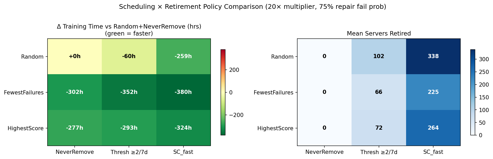
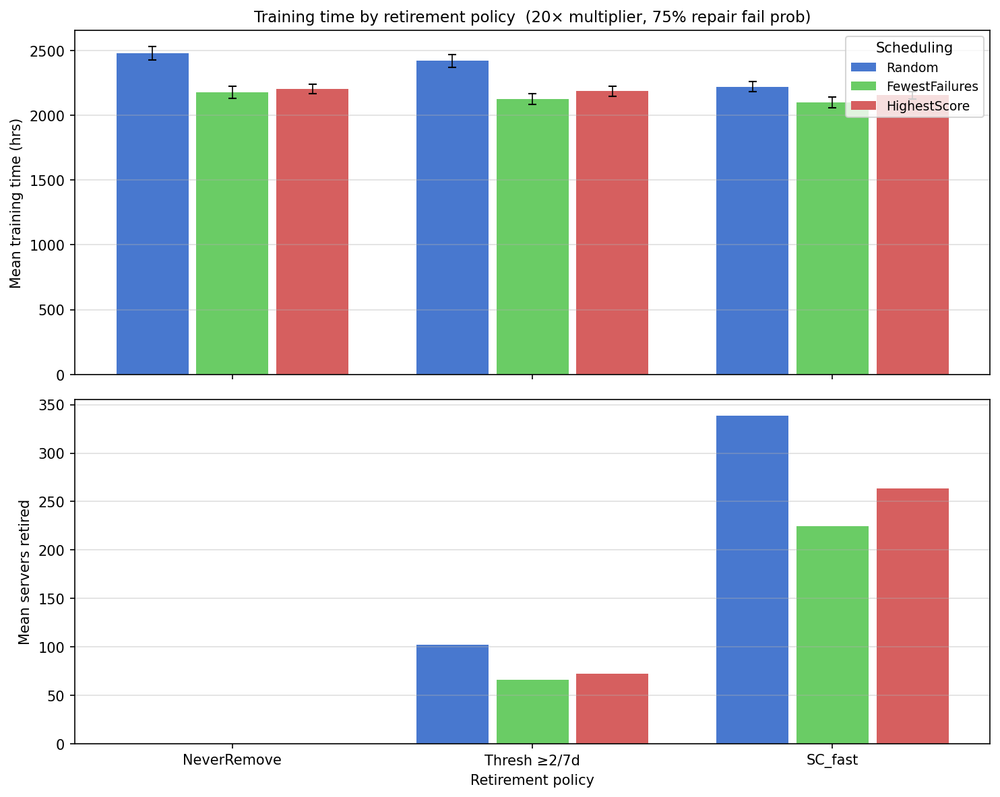
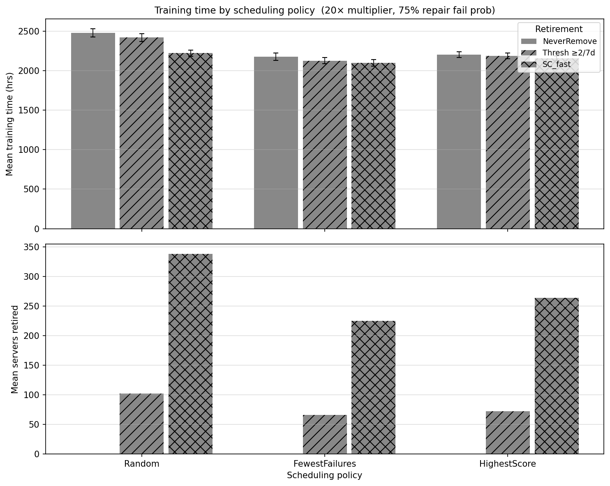

# Scheduling × Retirement Policy Comparison
## Does Smarter Scheduling Help — or Hurt?

**Data:** `examples/scheduling_comparison_figures/replications.csv` (9 cells × 15
replications, seeds 42–56) and `results.csv`, produced by
`examples/scheduling_comparison.py` at commit `be13c89` (run log:
`examples/scheduling_comparison_figures/run.log`). Date: 2026-11-20.

> **What changed on 2026-11-20.** Rerun after the paper-conformance fixes (CHANGELOG).
> The script does not set `diagnosis_probability`, so it now runs at the Table I
> default of **0.8**; the previous version used 1.0. That default change accounts for
> every difference: this regime never borrows a spare or stalls (0 preemptions in all
> runs, before and after), and three of the old runs reproduce exactly on the new code
> at diagnosis 1.0. Three conclusions changed:
>
> 1. `FewestFailuresFirst` and `HighestScoreFirst` are **no longer identical**.
>    `HighestScoreFirst`'s scores only move on diagnosed failures, `FewestFailuresFirst`
>    counts every failure, and at 0.8 they differ (§6).
> 2. **Smart scheduling + `ScoredRemoval` is now clearly the best combination**, 122 h
>    ahead of `Random + ScoredRemoval` (paired 95% CI ±21 h); at 1.0 they were tied.
> 3. **Smart scheduling alone now beats retirement alone** (−302 h vs −259 h; paired
>    difference 44 ± 35 h). At 1.0 retirement alone was ahead (−317 h vs −272 h).

---

> **Design note.** `Scheduler.do_host_selection` re-picks the *entire* job
> (`job_size + warm_standbys`) from the available pool each time it runs, so **one**
> full selection can bench every server the policy currently regards as bad, up to
> the pool's headroom (`working_pool_size - job_size - warm_standbys`). Between full
> selections, `Scheduler.swap_in_standby` replaces a failed active server with the
> oldest warm standby, FIFO, without consulting the policy; a full selection is
> re-triggered only once standbys run out.
>
> `FewestFailuresFirst`'s benefit is bounded by how much headroom exists relative to the
> bad-server population; by how long an exclusion lasts before FIFO swap-ins and
> servers returned from repair — cured or not — bring previously-excluded servers back
> into play at the next full selection; and by the fact that it sorts by *failure
> history*, so it can only bench a bad server that has already failed at least once. In
> this sweep's regime, headroom is 488 servers (`4,600 - 4,096 - 16`) against an
> initial bad population of ~368 (8% of the pool). Time-averaged faulty servers in the
> active job are **138.1** under `FewestFailuresFirst` vs **189.6** under `Random`, a
> **27%** reduction — not near-total exclusion.
>
> `faulty_in_pool_timeavg` counts bad servers across the whole working pool — active
> job included, per `MonitoredSimulator._monitor` in `examples/sweep_common.py`. It is
> *higher* under `FewestFailuresFirst` (262.9) than `Random` (222.2); subtracting the
> active-job count leaves the idle (benched) count: **124.8** under
> `FewestFailuresFirst` vs **32.6** under `Random`. `FewestFailuresFirst` keeps *more*
> bad servers in the cluster overall — a benched bad server never fails, so it never
> enters repair and never gets cured. It trades curing bad servers for avoiding them;
> it still wins here because avoiding a failure in the active job is worth more (one
> `recovery_time`) than the alternative cadence of failing and being repaired.
>
> At **paper-semantics defaults** (not this sweep's regime), headroom is only 48
> servers (`4,160 - 4,096 - 16`) against an initial bad population of ~624 (15%) — 7.7%
> coverage, vs 133% here — and systematic failures saturate early in the (256-day)
> default run (`SIMULATION_REPORT.md` §5a). Faulty servers in the active job are
> statistically indistinguishable between `FewestFailuresFirst` and `Random` there
> (`DIAGNOSIS_REALISTIC_REPORT.md`).
>
> **Information.** `FewestFailuresFirst` reads ground-truth failure counts, including
> the 20% of failures diagnosis misses — information an operator would not have.
> Removal policies, and `HighestScoreFirst` (whose scores come from a `ScoredRemoval`
> fed through the removal-policy hooks), only see diagnosed failures. So
> `HighestScoreFirst` is the realistic-information version of smart scheduling in this
> report, and the `FewestFailures` rows are an upper bound.

## 1. Executive Summary

This report tests all 3×3 = 9 combinations of scheduling policy and retirement policy
in the payoff regime (20× failure multiplier, 75% manual repair fail probability,
4600-server pool, diagnosis probability 0.8).

**Key findings:**

- **Smart scheduling + `ScoredRemoval` is the best combination.**
  `FewestFailures + ScoredRemoval` saves 380 h (2099.1 h); with realistic information,
  `HighestScore + ScoredRemoval` saves 324 h. Both beat `Random + ScoredRemoval`
  (−259 h): by 122 ± 21 h and 65 ± 23 h respectively (paired 95% CIs).

- **Smart scheduling alone (no retirement) saves 302 h (12.2%)** with ground-truth
  counts and 277 h with diagnosed-only scores — about as much as or more than
  `ScoredRemoval` alone (259 h), with no retirements.

- **Ground-truth failure counts are worth 25–59 h.** `FewestFailures` beats
  `HighestScore` by 25 ± 30 h without retirement (not significant), 57 ± 26 h with
  `ScoredRemoval` and 59 ± 19 h with `ThresholdRemoval`.

- **Retirement still adds something on top of smart scheduling**: `ScoredRemoval` adds
  78 ± 29 h to `FewestFailures`, `ThresholdRemoval` 50 ± 31 h (paired). With
  `HighestScore` the additions are 47 ± 30 h and 16 ± 25 h (the latter not
  significant).

- **The levers are partly substitutable.** `FewestFailures + ScoredRemoval` achieves 68%
  of the sum of the separate effects (−380 h against −561 h); with `ThresholdRemoval`,
  97%.

---

## 2. Simulation Regime

| Parameter | Value |
|---|---|
| `working_pool_size` | 4600 (488 above minimum 4112) |
| `spare_pool_size` | 200 |
| `job_size` | 4096 |
| `warm_standbys` | 16 |
| `job_length` | 14 days |
| `systematic_failure_rate_multiplier` | **20×** (bad TTF ≈ 2.4 days) |
| `systematic_failure_fraction` | 8% (≈ 368 bad servers) |
| `recovery_time` | 60 min |
| `prob_auto_to_manual` | 0.80 |
| `auto_repair_fail_prob` | 0.60 |
| `manual_repair_fail_prob` | 0.75 (effective fix rate ≈ 28%) |
| `diagnosis_probability` | 0.80 (Table I default) |
| Replications | 15 per cell |

**Baseline (Random + NeverRemove): 2479.3 ± 51.6 hrs** (2394.8 at diagnosis 1.0)
**Baseline ETR: 336 / 2479.3 = 13.6%** (job_length = 14 days = 336 hrs)

---

## 3. Full Results Table

ETR = 336 / mean_training_time. "At 1.0" is the previous report's mean (diagnosis 1.0).

| Scheduling | Retirement | Mean (hrs) | ETR | Std | Δ vs baseline | Retired | At 1.0 |
|---|---|---|---|---|---|---|---|
| Random | NeverRemove | 2479.3 | 13.6% | ±51.6 | 0.0h | 0 | 2394.8 |
| Random | Thresh ≥2/7d | 2419.7 | 13.9% | ±50.4 | −59.6h | 102 | 2319.1 |
| Random | ScoredRemoval | 2220.8 | 15.1% | ±38.1 | −258.5h | 338 | 2077.7 |
| FewestFailures | NeverRemove | 2177.2 | 15.4% | ±45.4 | −302.2h | 0 | 2122.5 |
| FewestFailures | Thresh ≥2/7d | 2127.1 | 15.8% | ±41.0 | −352.2h | 66 | 2090.4 |
| **FewestFailures** | **ScoredRemoval** | **2099.1** | **16.0%** | **±39.9** | **−380.2h** | **225** | 2065.9 |
| HighestScore | NeverRemove | 2202.6 | 15.3% | ±37.9 | −276.7h | 0 | 2122.5 |
| HighestScore | Thresh ≥2/7d | 2186.3 | 15.4% | ±38.2 | −293.1h | 72 | 2090.4 |
| HighestScore | ScoredRemoval | 2155.6 | 15.6% | ±29.0 | −323.7h | 264 | 2065.9 |

Per-cell standard errors are ≈7.5–13h (stdev ÷ √15). No cell was depleted. Paired
(same-seed) contrasts are quoted with 95% CIs below.

---

## 3a. Host Selection Activity

Mean full host-selection events per run, from `replications.csv` (15 replications/cell):

| Scheduling | Retirement | Mean host selections |
|---|---|---|
| Random | NeverRemove | 6.5 |
| Random | Thresh ≥2/7d | 12.9 |
| Random | ScoredRemoval | 25.0 |
| FewestFailures | NeverRemove | 6.1 |
| FewestFailures | Thresh ≥2/7d | 9.6 |
| FewestFailures | ScoredRemoval | 17.9 |
| HighestScore | NeverRemove | 6.2 |
| HighestScore | Thresh ≥2/7d | 10.5 |
| HighestScore | ScoredRemoval | 20.2 |

Retirement drives most of the host-selection activity (6 → 25 as retirement gets more
aggressive), not the scheduling policy. Each full selection re-picks the *entire* job
(§ design note), so the low count (6–25, vs ~1,760–2,140 failures per run) does not
mean the policy rarely acts.

---

## 4. Visualisations

### 4.1 Heatmap

### 4.2 Grouped by Retirement Policy

### 4.3 Grouped by Scheduling Policy

---

## 5. ETR Summary

ETR ranges from **13.6%** (Random + NeverRemove) to **16.0%**
(`FewestFailures + ScoredRemoval`) — a spread of **+2.4 percentage points**.

| Strategy | ETR | Interpretation |
|---|---|---|
| Random + NeverRemove (baseline) | 13.6% | 86.4% of time lost to failure overhead |
| Smart scheduling alone (FewestFailures / HighestScore) | 15.4% / 15.3% | +1.8 / +1.7 pp from avoiding bad servers |
| Random + ThresholdRemoval | 13.9% | +0.3 pp from retirement alone |
| Random + ScoredRemoval | 15.1% | +1.5 pp from retirement alone |
| Smart scheduling + ThresholdRemoval | 15.8% / 15.4% | +2.2 / +1.8 pp |
| **Smart scheduling + ScoredRemoval** | **16.0%** / 15.6% | **+2.4** / +2.0 pp |

---

## 6. Finding 1 — HighestScoreFirst is FewestFailuresFirst with diagnosed failures only

At diagnosis 1.0 the two policies produced identical results to the last decimal place.
At 0.8 they don't:

| Retirement | FewestFailures − HighestScore (paired) |
|---|---|
| NeverRemove | −25.4 ± 29.8 h (not significant) |
| Thresh ≥2/7d | −59.1 ± 19.0 h |
| ScoredRemoval | −56.5 ± 25.5 h |

**Why they were identical:** `HighestScoreFirst` ranks by descending `ScoredRemoval`
score, `initial_score − failure_penalty × failures + credits`. Uptime credits are
**inert** at 4096-server scale (mean run chunk ≈ 7 minutes; `time_period = 1 day`), so
the score is a decreasing function of the failure count, and ranking by it equals
ranking by ascending failure count.

**Why they now differ:** the score counts only the failures reported to the removal
policy, i.e. diagnosed ones; `FewestFailuresFirst` counts every failure
(`total_failure_count`). With 20% of failures undiagnosed, `HighestScoreFirst` behaves
like `FewestAttributedFailuresFirst` — what an operator relying on diagnosis would
actually have — and the gap above is the value of the failures diagnosis misses.

---

## 7. Finding 2 — Smart Scheduling Without Retirement Saves 277–302h

`FewestFailures + NeverRemove` saves **302.2h** (12.2%) against `Random + NeverRemove`
(2177.2h vs 2479.3h); with diagnosed-only scores, `HighestScore + NeverRemove` saves
**276.7h**. Both match or beat `Random + ScoredRemoval` (−258.5h): `FewestFailures`
by 43.6 ± 35.1 h (paired), `HighestScore` by 18.2 ± 28.7 h (not significant).

**Mechanism:** With ~368 bad servers in the pool (each failing every 2.4 days), random
selection assigns bad servers to the active job in proportion to their pool fraction
(~8%). Non-random selection pushes them to the back of the selection list. With enough
good servers to fill the 4112-server job (4232 good), servers known to be bad sit idle
and fail less often. Each avoided failure saves 60 minutes of checkpoint recovery.

Why scheduling now beats retirement alone: retirement acts only on diagnosed failures,
so it retires fewer servers (`Random + ScoredRemoval`: 338 per run, against 390 at
diagnosis 1.0) and saves less (−259 h against −317 h). Smart scheduling's saving grew
(−302 h against −272 h): the baseline got worse, while `FewestFailuresFirst`'s
ground-truth counts are unaffected by missed diagnoses.

---

## 8. Finding 3 — Smart Scheduling + ScoredRemoval Is Best

| Combination | Δ vs baseline | Retired |
|---|---|---|
| FewestFailures + ScoredRemoval | −380.2h | 225 |
| FewestFailures + ThresholdRemoval | −352.2h | 66 |
| HighestScore + ScoredRemoval | −323.7h | 264 |
| FewestFailures + NeverRemove | −302.2h | 0 |
| HighestScore + ThresholdRemoval | −293.1h | 72 |
| HighestScore + NeverRemove | −276.7h | 0 |
| Random + ScoredRemoval | −258.5h | 338 |
| Random + ThresholdRemoval | −59.6h | 102 |

`FewestFailures + ScoredRemoval` beats `FewestFailures + ThresholdRemoval` by
28 ± 31 h (not significant), so the two are tied at the top with ground-truth counts.
Smart scheduling also cuts how many servers `ScoredRemoval` retires (225 or 264 instead
of 338), because benched bad servers accumulate failures more slowly.

---

## 9. Finding 4 — Smart Scheduling and Retirement Overlap

| Combination pair | Δ (h), paired 95% CI |
|---|---|
| Adding FewestFailures scheduling to `ScoredRemoval` | −121.7 ± 20.5 |
| Adding HighestScore scheduling to `ScoredRemoval` | −65.2 ± 23.2 |
| Adding FewestFailures scheduling to `ThresholdRemoval` | −292.6 ± 38.2 |
| Adding `ScoredRemoval` to FewestFailures | −78.1 ± 28.5 |
| Adding `ThresholdRemoval` to FewestFailures | −50.0 ± 31.3 |
| Adding `ScoredRemoval` to HighestScore | −47.0 ± 30.4 |
| Adding `ThresholdRemoval` to HighestScore | −16.3 ± 25.1 |

**Why the levers overlap:** retirement removes bad servers and smart scheduling keeps
them out of the active job; both act on the same population, so once one has dealt
with most of them the other has less left to do. At diagnosis 1.0, adding smart
scheduling to `ScoredRemoval` changed nothing (−11.8 h, noise); at 0.8 it is worth
65–122 h, because retirement alone now misses the bad servers whose failures went
undiagnosed.

---

## 10. The Decomposition of Savings

| Strategy | Δ vs Random+NeverRemove |
|---|---|
| Smart scheduling alone (FewestFailures + NeverRemove) | −302h |
| Retirement alone: ThresholdRemoval (Random) | −60h |
| Retirement alone: ScoredRemoval (Random) | −259h |
| Smart scheduling + ThresholdRemoval | −352h |
| Smart scheduling + ScoredRemoval | −380h |
| **Expected additive, Threshold (302 + 60 = 362h)** | 352h achieved (97%) |
| **Expected additive, Scored (302 + 259 = 561h)** | 380h achieved (68%) |

At diagnosis 1.0 the corresponding shares were 87% and 56%: the levers overlap less
when retirement misses part of the bad population.

---

## 11. Practical Guidance

| Goal | Recommended combination | Rationale |
|---|---|---|
| Maximum training speed | Failure-aware scheduling + `ScoredRemoval(SC_fast)` | Best with either information level (−380h / −324h) |
| Avoid retirements entirely | Failure-aware scheduling + `NeverRemove` | Saves 277–302h, as much as `ScoredRemoval` alone |
| Moderate retirement with scheduling boost | `FewestFailures + ThresholdRemoval(2/7d)` | Tied with the best (−352h) at 66 retirements, if failure counts are ground truth |
| Retirement only | Prefer adding scheduling | `Random + ScoredRemoval` is 65–122h behind either combination |

Which failure counts a real scheduler sees matters: the `FewestFailures` rows assume
the operator knows about every failure, including those diagnosis missed. The
`HighestScore` rows are the realistic case when only diagnosed failures are recorded.

**When to use `HighestScoreFirst` beyond that:** at production scale (≥1000 servers),
only when `time_period` is set to minutes (matching actual run-chunk length) so that
uptime history differentiates servers beyond their failure count.

---

*Generated by `examples/scheduling_comparison.py` — regenerated 2026-11-20 at `be13c89`.*
