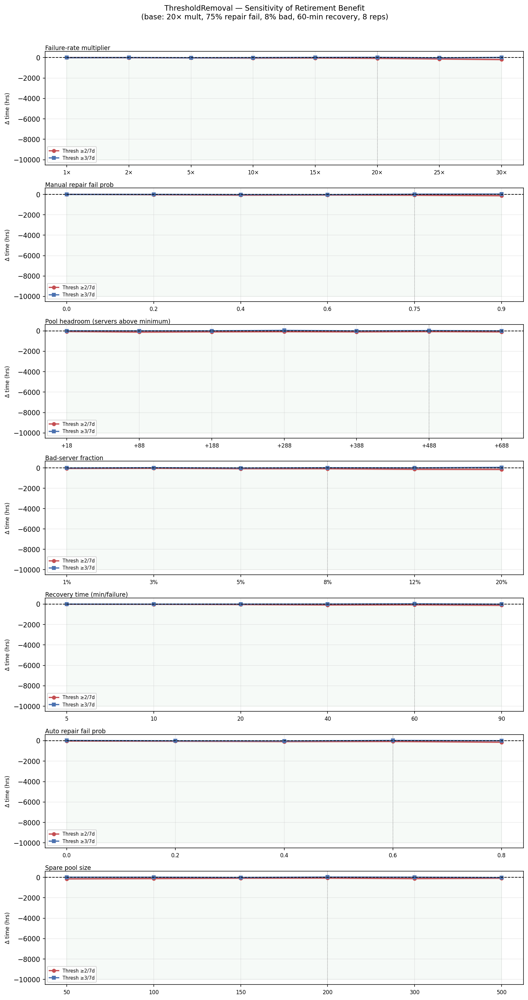
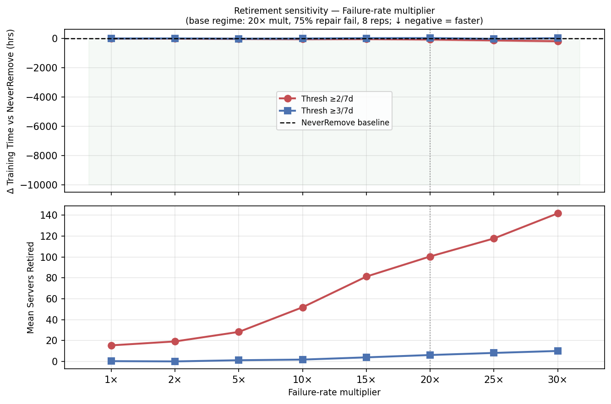
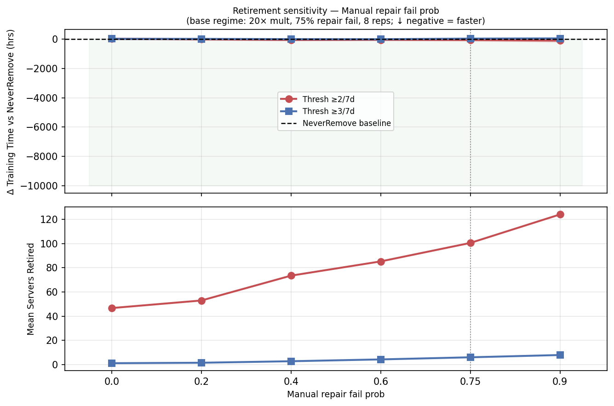
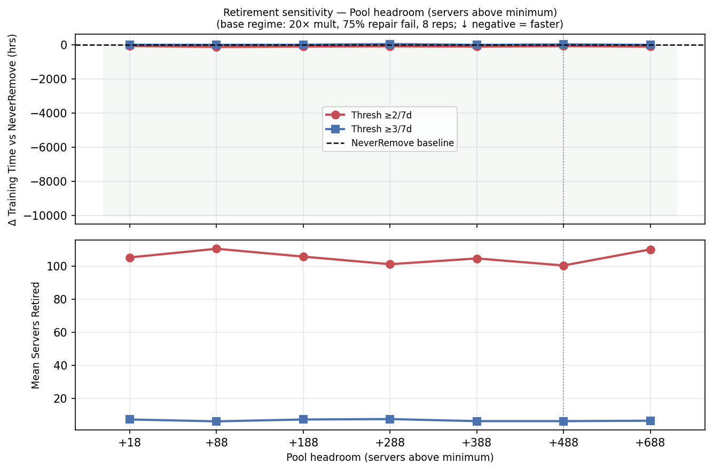
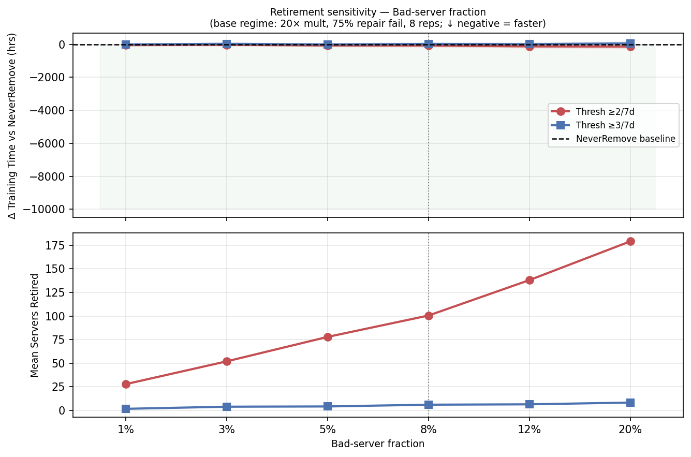
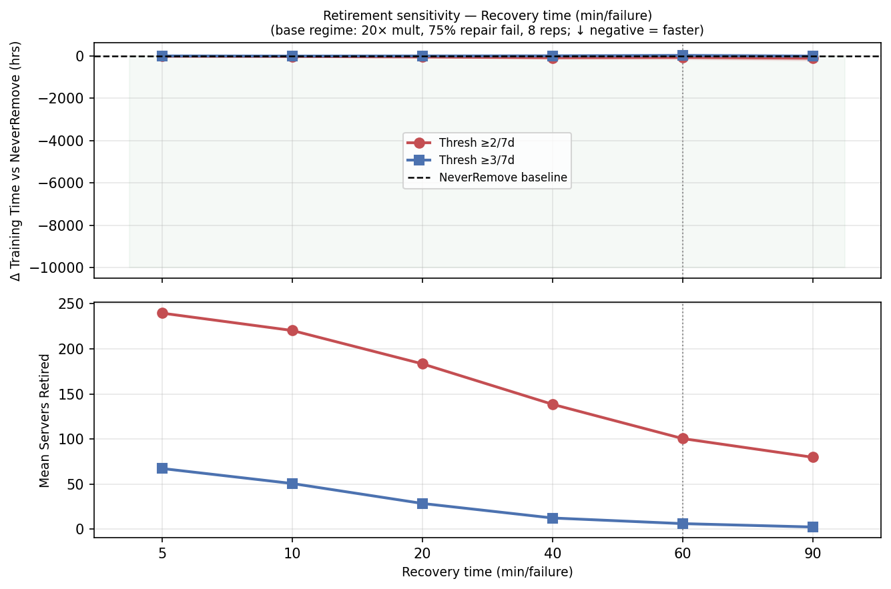
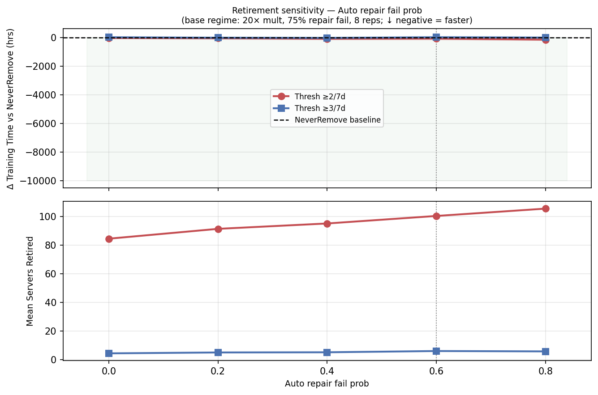
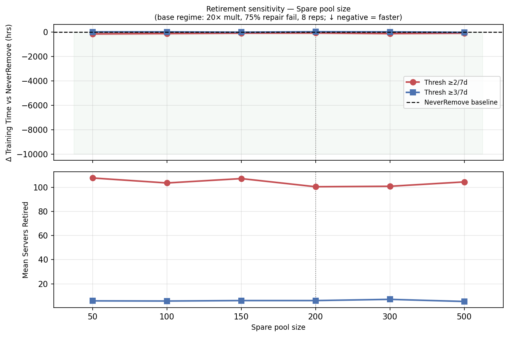

# ThresholdRemoval Sensitivity Analysis
## Where Active Server Retirement Has a Net Benefit

**Data:** `examples/threshold_sensitivity_figures/sensitivity_summary.csv` (132 rows: 44 cells ×
3 policies, 8 replications each; per-run rows in `replications.csv`), produced by
`examples/threshold_sensitivity.py` at commit `be13c89` (run log:
`examples/threshold_sensitivity_figures/run.log`). Repairs follow the paper's model:
`prob_auto_to_manual` is the probability that auto repair escalates, independent of the
silent auto-repair failure `auto_repair_fail_prob`. Date: 2026-11-20.

> **What changed on 2026-11-20.** Rerun after the paper-conformance fixes (CHANGELOG).
> The script does not set `diagnosis_probability`, so it now runs at the Table I default
> of **0.8**; the previous version used 1.0. That default change accounts for the
> differences in every cell except possibly the two smallest working pools: only the
> 4130- and 4200-server cells borrow spares (45 and 15 preemptions per run), where the new
> spare return could also contribute; no run stalls. `ThresholdRemoval` counts every
> failure in its window, diagnosed or not, but is only consulted when a server finishes
> repair — after a diagnosed failure — so it retires slightly fewer servers (100 vs 106
> at the baseline). The picture is the same: `Thresh
> ≥2/7d` is significant in 36 of 44 cells (was 35), `Thresh ≥3/7d` in 1 (was 1). The
> baseline saving is 72h (was 89h); the multiplier threshold for a significant saving
> moved from 20× down to 15×, and the bad-fraction one from 3% to 1% (with 3% itself
> not significant, see §4.4). With 8 replications per cell, individual cells move by
> ±30–60h between runs; read trends, not single cells.

---

## 1. Executive Summary

This report sweeps seven simulation parameters one-at-a-time from the **payoff regime** baseline
(20× failure multiplier, 75% manual repair fail probability, 4600-server pool, diagnosis
probability 0.8) to identify the conditions under which `ThresholdRemoval` saves training
time relative to `NeverRemove`.

Two policies are compared throughout:

| Policy | Config | Effective rule |
|---|---|---|
| **Thresh ≥2/7d** | `max_failures=2, window=7 days` | Retire after 2 failures in any 7-day window, checked when the server finishes repair |
| **Thresh ≥3/7d** | `max_failures=3, window=7 days` | Retire after 3 failures in any 7-day window, checked when the server finishes repair |

Bold deltas in the tables below differ from `NeverRemove` by more than two standard errors
(8 replications per cell, unpaired; standard errors of a difference are ≈2h at 5–10 min
recovery and ≈12–35h elsewhere).

**Key findings:**

- **Thresh ≥2/7d** saves time in most of the tested space: 36 of its 44 cells are more than
  two standard errors faster than `NeverRemove`, and none is significantly slower. Savings
  range from **19h (5-minute recovery) to 190h** (30× multiplier), and are **72h (2.9%)**
  at the baseline. The eight cells without a significant benefit are at the mild end of a
  severity axis (multiplier ≤10×, manual repair fail ≤0.2, no auto-repair failures) plus
  the 3% bad-fraction cell, whose neighbours on both sides are significant.
- **Thresh ≥3/7d** is far more conservative (retires 0–12 servers in most cells) and shows
  no reliable effect: 1 of its 44 cells is significant, and it is a *cost* (+43h at a
  4400-server pool), consistent with chance at 44 tests.
- The **failure-rate multiplier**, the **bad-server fraction** and the **manual repair fail
  probability** are the strongest gatekeepers of the retirement benefit: the saving grows
  with each. **Recovery time** scales the saving up to about 40 minutes.
- **Pool headroom and spare-pool size do not gate the benefit** in this sweep: `Thresh ≥2/7d`
  saves 63–151h at every headroom from +18 to +688 servers and every spare-pool size from
  50 to 500, with no depletion.

---

## 2. Simulation Baseline

All sweeps vary one parameter at a time from the following payoff-regime baseline:

| Parameter | Baseline value |
|---|---|
| `working_pool_size` | 4600 |
| `spare_pool_size` | 200 |
| `job_size` | 4096 |
| `warm_standbys` | 16 |
| `job_length` | 14 days |
| `random_failure_rate` | 2× default |
| `systematic_failure_rate_multiplier` | **20×** |
| `systematic_failure_fraction` | **8%** |
| `recovery_time` | **60 min** |
| `auto_repair_fail_prob` | **0.60** |
| `manual_repair_fail_prob` | **0.75** |
| `prob_auto_to_manual` | 0.80 |
| `diagnosis_probability` | 0.80 (Table I default) |
| Replications | 8 per data point |

The baseline NeverRemove time is **2502.0h ± 50.3h**.
Thresh ≥2/7d saves **71.8h** (−2.9%); Thresh ≥3/7d costs **18.9h** (+0.8%, not significant) at baseline.

**Effective Training Ratio (ETR)** = `336 hrs (job_length) / total_training_time`.
Baseline ETR (NeverRemove): **336 / 2502.0 = 13.4%**.
With Thresh ≥2/7d: 336 / 2430.2 = **13.8%** (+0.4 pp).
ETR values for all other configurations can be derived from the tables below as
`ETR = 336 / (NeverRemove_time + Δ)`.

---

## 3. Overview

Each panel shows training time (top) and servers retired (bottom) vs one swept parameter.

---

## 4. Parameter Sweeps

### 4.1 Failure-Rate Multiplier

| Multiplier | NeverRemove (hrs) | ETR (NR) | Thresh ≥2/7d Δ | Retired | Thresh ≥3/7d Δ | Retired |
|---|---|---|---|---|---|---|
| 1× | 1573.1 ± 41.1 | 21.4% | −1.4h | 15 | −5.2h | 0 |
| 2× | 1662.4 ± 29.3 | 20.2% | −11.0h | 19 | +0.0h | 0 |
| 5× | 1857.9 ± 43.5 | 18.1% | −30.6h | 28 | −18.3h | 1 |
| 10× | 2155.7 ± 58.0 | 15.6% | −42.1h | 52 | −11.3h | 2 |
| 15× | 2328.7 ± 53.1 | 14.4% | **−41.6h** | 81 | +12.9h | 4 |
| 20× | 2502.0 ± 50.3 | 13.4% | **−71.8h** | 100 | +18.9h | 6 |
| 25× | 2598.4 ± 43.2 | 12.9% | **−135.9h** | 118 | −30.0h | 8 |
| 30× | 2699.1 ± 57.7 | 12.4% | **−190.4h** | 142 | +14.5h | 10 |

**Thresh ≥2/7d crossover: 15×** — significant from 15× upward, with a saving that grows
with severity (42h → 72h → 136h → 190h at 15× → 20× → 25× → 30×). At 5× and 10× it saves
31–42h, which is suggestive (z ≈ −1.5 to −1.6) but not significant at this replication
count; at 1× and 2× the saving is near zero. Unlike the diagnosis-1.0 run, no point
estimate in this sweep is positive.

**Thresh ≥3/7d** never benefits reliably — it retires at most 10 servers at any
multiplier and the signal is swamped by noise.

**ETR range across multipliers:** NeverRemove ETR drops from 21.4% at 1× (low failures →
training close to ideal) to 12.4% at 30× (heavy recovery overhead).
Thresh ≥2/7d improves ETR by 0.4–0.9 pp at 20–30×.

---

### 4.2 Manual Repair Fail Probability

| Manual fail prob | Effective fix rate | NeverRemove (hrs) | ETR (NR) | Thresh ≥2/7d Δ | Retired | Thresh ≥3/7d Δ | Retired |
|---|---|---|---|---|---|---|---|
| 0.00 | 88% | 1952.5 ± 38.0 | 17.2% | +13.6h | 47 | +6.6h | 1 |
| 0.20 | 72% | 2058.7 ± 43.5 | 16.3% | −23.4h | 53 | +1.4h | 2 |
| 0.40 | 56% | 2198.8 ± 44.2 | 15.3% | **−70.6h** | 74 | −16.6h | 3 |
| 0.60 | 40% | 2324.1 ± 37.6 | 14.5% | **−58.3h** | 85 | −20.9h | 4 |
| 0.75 | 28% | 2502.0 ± 50.3 | 13.4% | **−71.8h** | 100 | +18.9h | 6 |
| 0.90 | 16% | 2694.8 ± 78.6 | 12.5% | **−119.5h** | 124 | +32.3h | 8 |

**Thresh ≥2/7d crossover: 0.40** (56% fix rate). At or below 0.2 (≥72% fix rate) too many
servers are genuinely repaired for retirement to help (+14h and −23h, both within noise).
From 0.4 upward broken servers keep returning to the pool and active retirement eliminates
recidivists; the saving is 58–72h from 0.4 to 0.75 and 120h at 0.9.

**Thresh ≥3/7d** shows no significant effect at any probability (−21h to +32h).

**ETR range:** NeverRemove ETR falls from 17.2% (fail prob 0.0) to 12.5% (0.9).

---

### 4.3 Pool Headroom (Working Pool Size)

Pool headroom = `working_pool_size − (job_size + warm_standbys)` = `working_pool_size − 4112`.

| Pool size | Headroom | NeverRemove (hrs) | ETR (NR) | Thresh ≥2/7d Δ | Retired | Thresh ≥3/7d Δ | Retired |
|---|---|---|---|---|---|---|---|
| 4130 | +18 | 2466.9 ± 63.8 | 13.6% | **−63.2h** | 105 | −3.9h | 7 |
| 4200 | +88 | 2476.5 ± 52.1 | 13.6% | **−120.9h** | 111 | −4.8h | 6 |
| 4300 | +188 | 2462.8 ± 31.9 | 13.6% | **−98.7h** | 106 | −0.3h | 7 |
| 4400 | +288 | 2446.3 ± 52.4 | 13.7% | **−82.2h** | 101 | **+43.3h** | 7 |
| 4500 | +388 | 2480.4 ± 43.7 | 13.5% | **−102.3h** | 105 | −6.2h | 6 |
| 4600 | +488 | 2502.0 ± 50.3 | 13.4% | **−71.8h** | 100 | +18.9h | 6 |
| 4800 | +688 | 2528.2 ± 56.6 | 13.3% | **−101.8h** | 110 | −5.0h | 6 |

**Thresh ≥2/7d benefits at every tested headroom, down to +18 servers.** Savings range from
63h to 121h with no monotone trend in headroom, and no run was depleted. The retirements
(~100 servers per run) are absorbed by the 200-server spare pool, which is why headroom does
not gate the benefit here; a cluster with neither headroom nor spares would deplete (see
`RETIREMENT_POLICY_REPORT.md` for the aggressive `≥1/7d` setting, which does).

`NeverRemove` training time is also nearly flat across headroom (2446–2528h), so tightening
the pool to +18 servers costs almost nothing in this regime.

**Thresh ≥3/7d** shows no effect at any headroom except one cell (+43h at +288, z = +2.1),
an isolated cost with no trend around it — about the one false positive expected among
44 tests at the 5% level.

---

### 4.4 Bad-Server Fraction

| Bad fraction | Bad servers (of 4800) | NeverRemove (hrs) | ETR (NR) | Thresh ≥2/7d Δ | Retired | Thresh ≥3/7d Δ | Retired |
|---|---|---|---|---|---|---|---|
| 1% | 48 | 1608.8 ± 24.9 | 20.9% | **−49.7h** | 28 | −5.3h | 2 |
| 3% | 144 | 1846.4 ± 36.0 | 18.2% | −30.1h | 52 | +25.4h | 4 |
| 5% | 240 | 2103.9 ± 39.5 | 16.0% | **−71.3h** | 78 | −8.3h | 4 |
| 8% | 384 | 2502.0 ± 50.3 | 13.4% | **−71.8h** | 100 | +18.9h | 6 |
| 12% | 576 | 3014.1 ± 65.1 | 11.1% | **−126.9h** | 138 | +5.6h | 6 |
| 20% | 960 | 4058.5 ± 48.0 | 8.3% | **−136.5h** | 179 | +53.7h | 8 |

**Thresh ≥2/7d saves time at every bad fraction tested**, significantly at all but 3%
(−30h, z = −1.4), and the saving grows to 127–137h at 12–20%. The 1% result (−50h,
z = −3.2) is larger than at 3%; at diagnosis 1.0 the order was reversed (−20h at 1%, −55h
at 3%). With 8 replications that ordering is noise; the robust statement is that the
saving is 30–70h up to 8% bad and roughly doubles above it.

**Thresh ≥3/7d** is not significant at any fraction (+54h at 20% is the largest, z = +1.5).

The absolute training time impact grows sharply with bad-server fraction because each bad
server contributes ~0.42 failures/day (TTF ≈ 2.4 days) × 60 min recovery overhead =
~25 min/day of wasted compute.

**ETR:** NeverRemove ETR degrades from 20.9% (1% bad fraction, few failures) to 8.3% (20%
bad fraction, severe failure load). Thresh ≥2/7d recovers 0.3–0.7 pp of ETR.

---

### 4.5 Recovery Time

| Recovery time | NeverRemove (hrs) | ETR (NR) | Thresh ≥2/7d Δ | Retired | Thresh ≥3/7d Δ | Retired |
|---|---|---|---|---|---|---|
| 5 min | 510.2 ± 4.2 | 65.9% | **−18.7h** | 240 | −2.7h | 67 |
| 10 min | 688.1 ± 9.6 | 48.8% | **−28.4h** | 220 | −8.1h | 51 |
| 20 min | 1046.0 ± 17.9 | 32.1% | **−51.3h** | 183 | −3.0h | 28 |
| 40 min | 1774.8 ± 40.5 | 18.9% | **−86.8h** | 138 | +2.5h | 12 |
| 60 min | 2502.0 ± 50.3 | 13.4% | **−71.8h** | 100 | +18.9h | 6 |
| 90 min | 3591.8 ± 57.6 | 9.4% | **−111.7h** | 80 | −12.8h | 2 |

**Thresh ≥2/7d benefits at every tested recovery time**, even 5 minutes (−18.7h,
z = −9.9), where NeverRemove takes only 510h. The absolute saving grows with recovery time
up to about 40 minutes (87h) and is roughly flat beyond (72h at 60 min, 112h at 90 min), so
as a share of training time it peaks at ~4.9% (20–40 min) and falls to ~3% at 60–90 min.

**Recovery time is the strongest continuous amplifier at the short end**, but at very
short recovery times the trade is poor: at 5 minutes the policy retires 240 servers to save
18.7h (3.7%).

**Thresh ≥3/7d** is not significant anywhere, even where it retires many servers
(67 at 5 min).

**ETR:** NeverRemove ETR rises sharply as recovery time shrinks — from 9.4% at 90 min to
65.9% at 5 min.

---

### 4.6 Auto Repair Fail Probability

`auto_repair_fail_prob` is the probability that the auto-repair stage silently fails. Only
the 20% of servers that are *not* escalated (`prob_auto_to_manual = 0.8`) are repaired by the
auto stage alone, so this parameter has a smaller effect on the baseline than the manual
repair fail probability does.

| Auto fail prob | NeverRemove (hrs) | ETR (NR) | Thresh ≥2/7d Δ | Retired | Thresh ≥3/7d Δ | Retired |
|---|---|---|---|---|---|---|
| 0.00 | 2306.1 ± 39.8 | 14.6% | −26.0h | 85 | +20.2h | 4 |
| 0.20 | 2369.0 ± 31.2 | 14.2% | **−46.9h** | 92 | −13.0h | 5 |
| 0.40 | 2439.8 ± 50.1 | 13.8% | **−84.7h** | 95 | −26.2h | 5 |
| 0.60 | 2502.0 ± 50.3 | 13.4% | **−71.8h** | 100 | +18.9h | 6 |
| 0.80 | 2599.0 ± 37.3 | 12.9% | **−147.9h** | 106 | −2.5h | 6 |

**Thresh ≥2/7d crossover: 0.2.** From 0.2 upward the saving is significant (47–148h),
largest at 0.8. At 0.0 (auto repair never fails silently) the saving (26h) is suggestive but
not significant. Even a 20% auto-fail rate leaves enough silently broken servers for
retirement to help.

**Thresh ≥3/7d** is not significant at any value (−26h to +20h).

---

### 4.7 Spare Pool Size

| Spare pool | NeverRemove (hrs) | ETR (NR) | Thresh ≥2/7d Δ | Retired | Thresh ≥3/7d Δ | Retired |
|---|---|---|---|---|---|---|
| 50 | 2521.3 ± 67.5 | 13.3% | **−151.3h** | 108 | +8.2h | 6 |
| 100 | 2517.2 ± 42.6 | 13.3% | **−118.7h** | 104 | +10.4h | 6 |
| 150 | 2510.7 ± 31.9 | 13.4% | **−87.4h** | 107 | −16.3h | 6 |
| 200 | 2502.0 ± 50.3 | 13.4% | **−71.8h** | 100 | +18.9h | 6 |
| 300 | 2509.8 ± 36.4 | 13.4% | **−125.2h** | 101 | +11.7h | 7 |
| 500 | 2504.3 ± 25.2 | 13.4% | **−83.9h** | 104 | −24.1h | 5 |

**Thresh ≥2/7d benefits at every spare-pool size from 50 to 500** (72–151h). The spare pool
does not gate retirement — retired servers come from the working pool and spares cover the
working-pool gaps — and it barely moves the `NeverRemove` baseline (2502–2521h). The
variation in savings across sizes is within what 8-replication noise allows and shows no
clear trend.

**Thresh ≥3/7d** shows no reliable effect at any spare-pool size.

---

## 5. Crossover Summary

The table below shows the first parameter value at which each policy produces a **net
time reduction more than two standard errors from `NeverRemove`** (with no pool depletion):

| Parameter | Thresh ≥2/7d | Thresh ≥3/7d |
|---|---|---|
| Failure-rate multiplier | **15×** (5–10× suggestive) | Never |
| Manual repair fail prob | **0.40** | Never |
| Pool headroom above minimum | **+18 servers** (lowest tested) | Never (one isolated significant *cost*) |
| Bad-server fraction | **1%** (lowest tested; 3% not significant) | Never |
| Recovery time | **5 min** (lowest tested) | Never |
| Auto repair fail prob | **0.20** (0.0 suggestive) | Never |
| Spare pool size | **50** (lowest tested) | Never |

At diagnosis 1.0 the multiplier and bad-fraction thresholds were 20× and 3%, and
`Thresh ≥3/7d` had one isolated significant saving (auto-repair fail 0.2). Both kinds of
shift are the size expected from 8-replication noise.

---

## 6. When Does ThresholdRemoval Pay Off?

Three conditions determine the benefit; the first two are gatekeepers and the third is an
amplifier:

### Condition 1 — Failures are both frequent and persistent

Retirement only helps when bad servers reliably accumulate two or more failures within the
7-day window and are then checked. In this sweep that requires either:
- **Failure rate multiplier ≥ 15×** (bad server TTF ≤ 3.1 days; benefit suggestive from
  5×), **or**
- a bad-server fraction in the tested range of 1–20% at the baseline 20× multiplier.

At 5× multiplier (TTF ≈ 8 days) bad servers fail about once per window on average, so
they rarely hit the threshold twice — the window resets too often. The window counts
every failure (`Server.failure_timestamps`, recorded before diagnosis), but the policy is
only consulted when a server finishes repair (`RepairShop`), so a bad server whose failure
goes undiagnosed skips that check and rejoins the pool.

### Condition 2 — Repair is ineffective

Retirement saves time only when retired servers are servers that *would keep failing* if
re-admitted. This requires:
- **Manual repair fail prob ≥ 0.40** (effective fix rate ≤ 56%), or
- **Auto repair fail prob ≥ 0.2**.

When repair is highly effective (manual fail prob ≤ 0.2), most returning servers are genuinely
fixed; retirement retires servers that would have been fine and gains nothing.

### Condition 3 — Failures are expensive (amplifier)

Each failure triggers a `recovery_time` checkpoint reload, so the saving scales with it up
to about 40 minutes (19h at 5 min, 28h at 10 min, 51h at 20 min, 87h at 40 min). Recovery
time is not a gatekeeper — the benefit is significant even at 5 minutes — but at short
recovery times it comes at the price of many retirements (240 servers for 19h at 5 min).

---

## 7. When ThresholdRemoval Does Not Help

### Thresh ≥3/7d — structurally too conservative

With `max_failures=3`, a server must fail three times within 7 days, and be checked at the
end of a repair while all three are in the window, to be retired. The data show 0–12 servers retired per run at most settings, so
the policy misses the vast majority of recidivists in the 14-day payoff regime with 384 bad
servers cycling through the pool. It shows no reliable effect anywhere in this sweep, and
its point estimates flip sign from cell to cell.

### Thresh ≥2/7d at the mild end of each severity axis

At multipliers ≤10×, manual repair fail probability ≤0.2, and 0% auto-repair failures, the
point estimates range from +14h to −42h and none is significant. Retirement removes servers
that repairs would have fixed without reducing recurring failures enough to matter.

---

## 8. Practical Guidance

| Scenario | Recommendation |
|---|---|
| Failure multiplier ≥ 15× AND manual repair fail prob ≥ 0.4 | Use `Thresh ≥2/7d` — saves roughly 40–190h (2–7%) |
| Failure multiplier 5–10× | Modest, suggestive benefit (31–42h); worth it if retirements are cheap, but not significant at 8 replications |
| Failure multiplier ≤ 2× OR manual repair fail prob ≤ 0.2 | Neither policy helps measurably; NeverRemove is sufficient |
| Bad-server fraction ≥ 12% | Use `Thresh ≥2/7d` — saves 127–137h |
| Pool headroom or spare pool size | Not a reason to avoid retirement in this sweep: benefit at +18 headroom and at 50 spares, no depletion |
| Recovery time ≲ 10 min per failure | Retirement saves little (19–28h) for 200+ retirements; probably not worth the complexity |
| `Thresh ≥3/7d` over `Thresh ≥2/7d` | Only for a depletion-safety margin; it has no measurable training-time benefit |

**When to use `Thresh ≥3/7d` instead of `Thresh ≥2/7d`:**
`Thresh ≥3/7d` retires 10–50× fewer servers and is therefore much safer against pool
depletion, but it captures essentially none of the benefit. Prefer it only when depletion
risk dominates, e.g. a cluster with little headroom and a small spare pool.

**Compared with scheduling.** In the same baseline regime, failure-aware host selection
with no retirement saves 277–302h, four times `Thresh ≥2/7d`'s 72h, and adding
`Thresh ≥2/7d` on top of it saves a further 16–50h (`SCHEDULING_COMPARISON_REPORT.md`).

---

*Generated by `examples/threshold_sensitivity.py` — regenerated 2026-11-20 at `be13c89`.*
